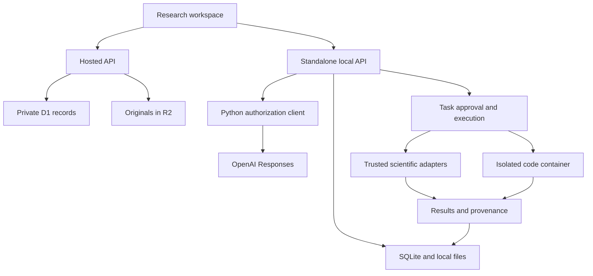

# Evidarium

**Research you can trace.** A chat-centered research workspace connecting literature, original files, screening decisions, explicit evidence, and recorded computation.

[Open the hosted workspace](https://evidarium.mikhaeelatef.chatgpt.site) · [User guide](https://evidarium.mikhaeelatef.chatgpt.site/guide.html) · [Download the local edition](https://evidarium.mikhaeelatef.chatgpt.site/downloads/evidarium-local.zip)

**Release 0.1.0 — early working release.** This repository contains working application code and real integrations, with the verification boundaries documented below. It is not a validated autonomous scientist, a replacement for supervision or laboratory work, or an established breakthrough. It does not promise perfect answers, unlimited files/context, or universal format understanding.

## The central idea

A fluent answer is not the research record. Evidarium keeps that record explicit:

1. **Question and protocol.** Save the question, eligibility criteria, and search permission in a versioned activity trail.
2. **Evidence.** Search PubMed or Crossref, retain identifiers, and make stage-specific inclusion/exclusion decisions with reasons.
3. **Originals and coverage.** Store original bytes, check upload parts, and separately record whether text extraction succeeded, was partial, or was unavailable.
4. **Evidence receipts.** Attach a scientific claim to an exact stored passage and label it as supporting, contradicting, or contextual evidence. The server checks text presence. A person separately reviews the interpretation.
5. **Computation.** Prepare a task, inspect its parameters and input fingerprint, approve it, then retain its actual result or error and execution provenance.
6. **Continuity.** Keep conversations, notes, decisions, and results with the project. Export a portable record; imported outcomes remain explicitly external.

An exact quote match proves text presence, not scientific truth. An execution record proves a particular computation ran, not that its assumptions were appropriate. These distinctions are part of the data model.

## Two deployment modes

| Capability | Hosted workspace | Standalone local edition |
|---|---|---|
| Private projects and protocol | ChatGPT identity, D1 storage | Single-user local SQLite |
| Literature search and screening | PubMed + Crossref | Same endpoints and workflow |
| Original file storage | R2 multipart uploads | Local filesystem multipart uploads |
| Evidence receipts | Saved source abstracts | Abstracts and extracted passages |
| ChatGPT plan inference | **Not enabled** | Official open-source local-app OAuth flow |
| Scientific computation | **Not enabled** | Explicitly approved Python/R/optional engines |
| Project interchange | JSON and CSV | Same format; originals separately |
| Automatic cloud/local sync | **Not implemented** | Import/export only |

The local edition is a complete standalone application served on `http://127.0.0.1:4317`. It is not an authorization bridge for the hosted site. ChatGPT identity used to sign in to a website is distinct from permission to consume a ChatGPT plan. The official local open-source flow does not automatically authorize a remote hosted service. Hosted plan inference requires the appropriate OpenAI approval and integration.

The real account-specific model catalog is fetched after authorization. The selected model slug is sent unchanged; inference never silently substitutes another model. Availability and quota are controlled by the account/provider. This application does not establish a universal “best model,” inherit ChatGPT memory, or import existing ChatGPT conversations.

## Run the local release

1. Install **Node.js 22.13+** and **Python 3.11+** from their official vendors.
2. Download and extract `evidarium-local.zip` from the link above.
3. macOS/Linux: run `bash start.sh`. Windows: run `./start-windows.ps1` from PowerShell. If your system policy blocks scripts, follow your organization's approved procedure; you can also run the documented commands in [Local setup](docs/local-setup.md) individually.
4. Keep the terminal open. The app opens the loopback URL above.
5. Choose **Connect your research engine → Continue with ChatGPT**. Complete authorization on OpenAI's site. Choose an available model and send a message.
6. Create a project, upload a file, prepare an analysis, review it under **Activity**, then approve.

The launcher creates a project-local `.venv` and downloads only the pinned base Python packages. It does not install heavyweight scientific engines, Docker, R, Julia, or model weights. A secure OS credential store is required. Linux needs a working Secret Service/keyring session.

From source:

```bash
corepack pnpm install --frozen-lockfile
corepack pnpm build:local
bash start.sh
```

The release contains prebuilt local UI assets; no frontend build is needed to use that download. Default data lives in `~/.evidarium`. See [configuration and backup](docs/local-setup.md).

## Scientific engines

All adapters call actual packages or runtimes. Missing dependencies produce errors, not simulated research results. **Optional adapters have not passed end-to-end scientific validation in this release.** They are explicitly experimental and require independent evaluation before relying on their outputs.

| Engine | Actual operation | Status and constraints |
|---|---|---|
| Base extraction | pypdf, python-docx, openpyxl, UTF-8 text readers | Text and CSV execution tested; format-specific coverage reported. No default OCR or image interpretation. |
| Descriptive CSV analysis | NumPy finite-number summaries | Tested against a hand-computed reference and through the real worker protocol. |
| Docling | Structured document conversion through `DocumentConverter` | Optional; select `engine: "docling"`; additional models/resources may download. |
| metafor | R random-effects REML meta-analysis, Knapp–Hartung inference | Optional R adapter; requires sampling variances and explicit independent-effects confirmation. Not arbitrary meta-analysis. |
| ASReview | Learning from included/excluded labels, ranking remaining records | Optional; preserves human decisions and screening stage. Does not certify recall. |
| PySR | Symbolic regression, fixed-seed train/test split | Optional Julia dependency; candidate equations are not established laws. |
| INDRA | Parse supplied INDRA statement JSON into mechanistic claim data | Optional; does not pretend a mechanistic reader is installed or that claims are experimentally validated. |
| PaperQA2 | `Docs` ingestion/query with an explicitly configured local Ollama model | Optional; separate specialist model, not ChatGPT subscription inference. |
| OpenScholar | Its upstream `run.py` in a configured local GPU environment | Experimental; requires upstream input schema, model weights, and runtime. |
| Biomni | A1 inside a configured offline Docker worker with a local model | Experimental recipe; heavy environment and suitable model required. Network-dependent tools cannot work offline. |
| Custom Python | Reviewed code in a constrained Docker container | Network disabled, read-only root, limited CPU/memory/processes/time; optional image must be built first. |

See [engine contracts and exact parameters](docs/engines.md). We do not present optional installations as verified ready-to-use capabilities.

## Architecture



The same React interface and shared HTTP application run in both editions. The hosted route obtains a verified ChatGPT identity server-side. Every project child lookup checks parent ownership. The local API binds only to loopback and rejects foreign hosts/origins. OAuth tokens stay in the OS credential store and are never sent to the hosted service or stored in the browser.

Read [Architecture](docs/architecture.md), [Security and privacy](SECURITY.md), and [API reference](docs/api.md).

## Verification

The release checks include:

- TypeScript compilation and both frontend/deployment builds.
- HTTP-core tests covering account isolation, cross-origin rejection, DOI deduplication, exclusion reasons, upload integrity/missing parts, export/import, provider failures, task approval/failure, evidence receipts, and search restrictions.
- Python tests for known CSV results, extraction, bounded ingestion, unknown-engine rejection, and streamed-event parsing.
- A real Python worker subprocess computing a known CSV result.

These are not live OAuth, GPU, R, Docker, accessibility, cross-browser, load, penetration, or scientific-validation certifications. The development environment does not provide supported browser QA for this Site. See [verification record](docs/verification.md) for exact results and remaining gates.

```bash
node --test tests/*.test.mjs
.venv/bin/python -m unittest discover -s tests -p 'test_*.py' -v
EVIDARIUM_TEST_PYTHON="$PWD/.venv/bin/python" node --test tests/worker.test.mjs
```

The worker test is skipped without an explicitly provided Python environment. No tests silently call a paid model or use an account credential.

## Explicit limits

- File storage: **2 GiB per file**, **200 files per project**, **8 GiB per account** in this release. Any byte format can be stored within those bounds; only documented formats can be extracted.
- Uploads: 8 MiB parts checked with SHA-256. Interrupted uploads remain visible and removable; automatic resume is not implemented.
- Extraction: default 300 PDF pages, 10,000 spreadsheet rows per sheet, and 2,000,000 extracted characters. Coverage warnings are retained. These are practical bounds, not model context promises.
- CSV calculations: maximum 100,000 rows; PySR uses at most 20,000 rows/15 features. Bounds reject unsupported calculations rather than quietly analyzing a truncated dataset.
- Conversation input: at most 24 recent messages/48,000 characters plus selected evidence. Search retrieves up to 12 term-overlap matches; this is not comprehensive semantic memory.
- Research loop: six model rounds; a worker run has a 35-minute upper bound. Provider context, time, and quota limits can end a request earlier. Partial output remains marked partial.
- Search: up to 20 records per PubMed or Crossref request. This is exploratory discovery, not a complete systematic search or a PRISMA-certified review.
- Import: UI accepts a 2 MiB project JSON; endpoint maximum 3 MiB, with collection limits documented in the guide. Export includes full audit history; file contents are separate.
- One local analysis and one local chat run at a time. Optional engines may need more resources than the machine provides.

## What is not implemented

Institutional multi-user collaboration, automatic distributed/cloud compute rental, full citation-manager interoperability, journal submission, complete qualitative-analysis workflows, a LaTeX thesis IDE, general audio/video transcription, autonomous wet-lab work, guaranteed discovery, universal parsing, cryptographically tamper-proof audit logs, automatic project sync, and approved hosted ChatGPT plan inference are not implemented. There are no buttons claiming these capabilities work.

A website permission prompt alone cannot grant arbitrary access to a person's computer. The standalone application and per-task approval are the concrete execution mechanism used here.

## Publishing and GitHub

The hosted edition uses the ChatGPT Sites Vinext starter, D1, and R2. `.openai/hosting.json` identifies the deployment; preserve that identity when updating this Site. The Sites publishing workflow owns source synchronization, builds, migrations, and deployment. Do not copy another user's deployment identity when forking.

A GitHub repository and a running website are different deliverables. The website link above is the application entry point; GitHub stores source and documentation. The source archive includes a portable local release path and the hosted source. Do not claim a GitHub repository exists until its actual creation and contents have been verified.

## Roadmap and quality bar

The next priority is a real evaluation suite: citation support judged by researchers, extraction coverage against reference documents, study matching, reproducible statistical fixtures, and user completion of a research workflow. Richer planning, exact-passage retrieval, and domain-specific analysis should be driven by those results. More model calls or more integration logos are not evidence of higher scientific quality.

The [Theioptera review](docs/theioptera-review.md) documents the inspected workflow and the specific improvements it informed. It does not claim Evidarium has already outperformed that product.

## License and attribution

Original Evidarium application code is MIT licensed. Dependencies, model weights, datasets, and papers keep their own terms. `metafor` is GPL-2-or-later and invoked as an independently installed R program; this repository does not relicense it. See [third-party notices](THIRD_PARTY_NOTICES.md). Upstream starter license notices are retained. No original article text, user research, credentials, or model weights are bundled with the release.
